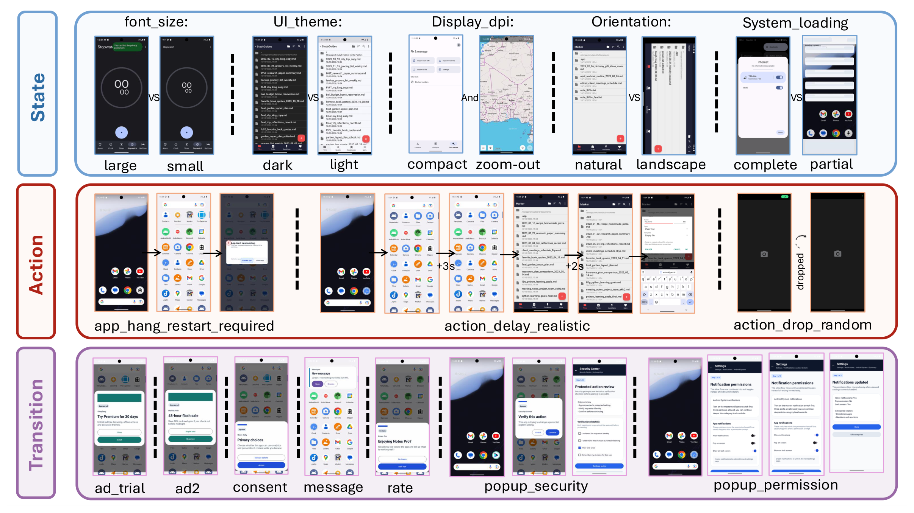
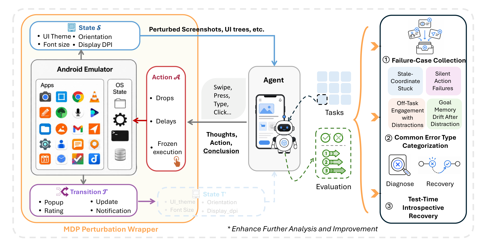
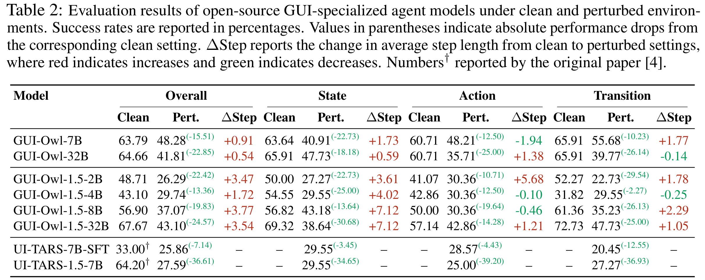

<div align="center">

# AndroidReality

### How Far Are Mobile Agents from the Real World?


[](https://arxiv.org/abs/2608.07775)

A perturbation benchmark and recovery toolkit for mobile GUI agents, built on AndroidWorld.

</div>

<p align="center">
  
</p>

AndroidReality keeps the 116 AndroidWorld tasks, their success checks, the emulator interface, and the action space. It adds a wrapper between the agent and the emulator that injects realistic state, action, and transition perturbations. The repository also includes Test-Time Introspective Recovery (TTIR), a training-free recovery layer.

Everything needed to run the benchmark is in this repository, including the AndroidWorld code. You do not need to install AndroidWorld separately.

<p align="center">
  
</p>

## Setup

You need Linux with KVM, conda, and `ffmpeg`. Serving a model needs a GPU: one NVIDIA A100-class GPU for models up to 8B, and two for the 32B models.

**1. Clone and create the Python environment**

```bash
git clone https://github.com/Xiao0o0o/AndroidReality.git
cd AndroidReality
conda create -n android_reality python=3.11.8 -y
# AndroidWorld reads app databases that need SQLite FTS4. Newer default builds omit it.
conda install -n android_reality -c conda-forge sqlite=3.50.4 -y
conda activate android_reality
pip install -r requirements.txt
sudo apt install ffmpeg
```

**2. Create the Android emulator**

Install [Android Studio](https://developer.android.com/studio), open **Device Manager**, and create a virtual device with these settings:

| Setting | Value |
| --- | --- |
| Hardware | Pixel 6 |
| System image | Tiramisu, API 33, Google APIs, x86_64 (no Play Store) |
| AVD name | `AndroidWorldAvd` |

If your Android SDK is not in `~/Android/Sdk`, set `ANDROID_SDK_ROOT` to its location.

**3. Create the model server environment**

vLLM has its own dependencies, so it needs a separate environment. This setup was tested with `vllm==0.11.0` and `transformers==4.57.1`.

```bash
conda create -n vllm python=3.11 -y
conda activate vllm
pip install vllm==0.11.0 transformers==4.57.1
```

## Run the benchmark

A run needs three terminals open at the same time. Start each one in the `AndroidReality` directory.

| Terminal | Used for | Conda environment | Stays running |
| --- | --- | --- | --- |
| 1 | Android emulator | None | Yes |
| 2 | Model server | `vllm` | Yes |
| 3 | Setup and experiments | `android_reality` | No, you run commands here |

**Terminal 1: start the emulator**

```bash
bash scripts/start_emulator.sh
```

Wait until the Android home screen appears, then leave this terminal running. On a machine with no display, run `bash scripts/start_emulator.sh -no-window` instead.

**Terminal 2: serve a model**

```bash
conda activate vllm
bash scripts/serve_model.sh gui_owl_7b
```

The first run downloads the model weights. Leave this terminal running. To use a different model, press `Ctrl+C` here and serve the next one.

If the model server is on another machine, run this step there and set `BASE_URL` in Terminal 3, for example `export BASE_URL=http://gpu-host:4243/v1`.

**Terminal 3: check the server**

```bash
conda activate android_reality
curl http://127.0.0.1:4243/v1/models
```

The response should list the model you served.

**Terminal 3: install the apps (first time only)**

With the emulator running, install the AndroidWorld apps and the perturbation helper app. This takes several minutes and only needs to be done once per AVD.

```bash
python scripts/setup_emulator.py
```

A warning that the Contacts app could not find `Don't allow` is expected and does not affect the tasks.

The helper app is prebuilt at `perturbation_helper_android_studio/prebuilt/app-debug.apk`. To build it yourself, open `perturbation_helper_android_studio/` in Android Studio with Java 17.

**Terminal 3: run the experiments**

```bash
# One task, as a quick test
TASKS=AudioRecorderRecordAudio bash scripts/run_gui_owl.sh gui_owl_7b perturbed

# All 116 tasks
bash scripts/run_gui_owl.sh gui_owl_7b clean
bash scripts/run_gui_owl.sh gui_owl_7b perturbed

# With TTIR
TTIR=1 bash scripts/run_gui_owl.sh gui_owl_7b perturbed
TTIR=1 bash scripts/run_gui_owl.sh gui_owl_7b clean

# UI-TARS, after serving the matching model
bash scripts/run_ui_tars.sh ui_tars_1.5_7b perturbed
```

### Models in the paper

| Model | Serve (Terminal 2) | Run (Terminal 3) |
| --- | --- | --- |
| GUI-Owl-7B | `serve_model.sh gui_owl_7b` | `run_gui_owl.sh gui_owl_7b ...` |
| GUI-Owl-32B | `serve_model.sh gui_owl_32b` | `run_gui_owl.sh gui_owl_32b ...` |
| GUI-Owl-1.5-2B | `serve_model.sh gui_owl_1.5_2b` | `run_gui_owl.sh gui_owl_1.5_2b ...` |
| GUI-Owl-1.5-4B | `serve_model.sh gui_owl_1.5_4b` | `run_gui_owl.sh gui_owl_1.5_4b ...` |
| GUI-Owl-1.5-8B | `serve_model.sh gui_owl_1.5_8b` | `run_gui_owl.sh gui_owl_1.5_8b ...` |
| GUI-Owl-1.5-32B | `serve_model.sh gui_owl_1.5_32b` | `run_gui_owl.sh gui_owl_1.5_32b ...` |
| UI-TARS-7B-SFT | `serve_model.sh ui_tars_7b_sft` | `run_ui_tars.sh ui_tars_7b_sft ...` |
| UI-TARS-1.5-7B | `serve_model.sh ui_tars_1.5_7b` | `run_ui_tars.sh ui_tars_1.5_7b ...` |

### Results

Each run creates `random_perturb_runs/session_<time>_<model>_<setting>/`:

| Path | Contents |
| --- | --- |
| `summary.json` | Success per task and aggregated by perturbation profile. |
| `manifest.jsonl` | The perturbation and exact command for every task. |
| `combined.log`, `logs/` | Session log and per-task logs. |
| `trajs/` | Screenshots and actions. |

To classify the failures in a finished perturbed session:

```bash
python analyze_random_perturb_session.py --session-dir random_perturb_runs/<session>
```

## Perturbations

The paper groups the two locale formats into one perturbation type, giving 24 types. The code runs them as separate profiles, giving 25.

| Family | Profiles |
| --- | --- |
| State | `font_size_large`, `font_size_small`, `ui_theme_dark`, `display_size_dpi_compact`, `display_size_dpi_zoomed_out`, `orientation_landscape`, `locale_date_format_us12`, `locale_date_format_eu24`, `partial_loading_skeleton` |
| Action | `execution_delay_loading`, `execution_delay_frozen`, `app_hang_restart_required`, `state_reset_home`, `action_delay_realistic`, `action_drop_random` |
| Transition | `bottom_sheet_consent`, `popup_permission`, `popup_security`, `interstitial_ad`, `ad_trial_offer`, `rate_dialog`, `update_system`, `update_app_sheet`, `notification_message`, `notification_delivery` |

To run only some of them, set `PROFILE_NAMES`, for example `PROFILE_NAMES=font_size_small,popup_security`.

## Repository layout

```text
android_world/                       AndroidWorld, with the changes in docs/UPSTREAM_CHANGES.md
mdp_perturbation/                    Perturbation wrappers
downstream_task/                     TTIR
ui_tars_runner/                      UI-TARS agent and runner
perturbation_helper_android_studio/  Helper app for pop-ups, ads, and notifications
run_ma3.py                           Runs GUI-Owl on one task
run_random_perturb_batch.py          Runs a session and samples perturbations
scripts/                             Setup, model serving, and benchmark entry points
```

## Results

<p align="center">
  
</p>

## Citation

```bibtex
@misc{liu2026androidreality,
  title         = {AndroidReality: How Far Are Mobile Agents from the Real World?},
  author        = {Liu, Xiaoou and Da, Longchao and Chen, Hanyang and Ling, Yuan and Wei, Hua},
  year          = {2026},
  eprint        = {2608.07775},
  archivePrefix = {arXiv},
  primaryClass  = {cs.AI}
}
```

## Acknowledgements and license

AndroidReality builds on [AndroidWorld](https://github.com/google-research/android_world) and the [Mobile-Agent-v3](https://github.com/X-PLUG/MobileAgent) evaluation code. See [NOTICE](NOTICE) and [docs/UPSTREAM_CHANGES.md](docs/UPSTREAM_CHANGES.md).

This project is released under the Apache License 2.0. See [LICENSE](LICENSE).
